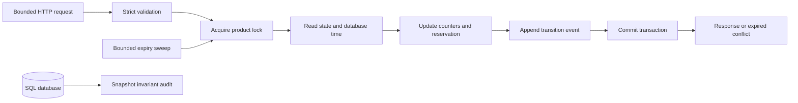

# StockHold

StockHold is a compact inventory reservation API with transactional holds, per-SKU idempotency, expiry recovery and an inspectable audit trail. **Verified:** 79 tests, a real HTTP demo, clean wheel installation, and CI covering SQLite, PostgreSQL, Windows and Docker. See the [validation evidence](docs/validation.md) for scope and results.

StockHold uses SQL transactions to preserve inventory while reservations change state. See the [design and milestone plan](docs/design.md). It is a local educational service using synthetic products, with no authentication, payment processing or production deployment.

## Run the demo

Requires Python 3.11 or 3.13. From the repository root:

```bash
python -m venv .venv
# Linux/macOS:
source .venv/bin/activate
# Windows PowerShell instead:
# .\.venv\Scripts\Activate.ps1
python -m pip install -r requirements.lock
python -m pip install --no-deps -e .
python -m pip check
python scripts/demo.py
```

The demo creates a temporary SQLite database and loopback HTTP server. It submits 16 competing requests for five units, 12 requests with one idempotency key, confirmations and a cancellation, then waits for a real database-clock expiry and runs recovery. It audits all final counters and history, stops the server, and removes temporary data. There are no paid services, private datasets or network dependencies after installation. All product names and requests are synthetic.

Observed demo outcomes: five successful competing holds and eleven stock conflicts; one new same-key hold and eleven replays; two units released by expiry; three products, seven reservations and twelve audit events with no invariant violations. These fixed correctness scenarios are not throughput benchmarks or production outcomes.

To keep a local API running, use `stockhold serve`. Open http://127.0.0.1:8000/docs for route information. The manually streamed parser enforces byte limits, so Swagger does not generate request-body forms. Use the checked-in request examples:

```bash
# Use curl.exe instead of curl in Windows PowerShell.
curl -H "Content-Type: application/json" --data-binary @examples/product.json http://127.0.0.1:8000/v1/products
curl -H "Content-Type: application/json" -H "Idempotency-Key: demo-order-1" --data-binary @examples/reservation.json http://127.0.0.1:8000/v1/reservations
```

`GET /v1/products/DEMO-ITEM` returns total, available, reserved and committed counters. Valid SKU characters are uppercase letters, digits, `_` and `-` (1–48 characters). Quantities must be integer 1–1,000,000. Duplicate SKUs conflict; inputs are validated without coercing booleans or strings into quantities. Creating products or reservations requires JSON and accepts at most 4 KiB, including streamed requests without Content-Length. No submitted customer data is needed or stored.

Default database: `sqlite:///stockhold.db`. Override with `STOCKHOLD_DATABASE_URL` or `stockhold serve --database-url ...`; `.env.example` documents placeholders and is not loaded automatically. The process binds loopback by default. Do not expose this unauthenticated teaching service publicly.

```bash
python -m pytest -q
python -m ruff check .
python -m ruff format --check .
python -m build
```

Tests use temporary SQLite databases by default. `TEST_DATABASE_URL` optionally selects a disposable PostgreSQL database; tests delete their own test tables during setup/teardown, so use a dedicated test database. CI exercises both engines. Never point tests at data you need to keep.

If PowerShell activation is restricted, use `.\.venv\Scripts\python.exe` and `.\.venv\Scripts\stockhold.exe` directly. See [validation evidence](docs/validation.md) for exact results and environments; the Git history records real implementation, verification and fix milestones.

## Reserve, confirm and cancel

`POST /v1/reservations` accepts `{"sku":"DEMO-ITEM","quantity":2,"ttl_seconds":300}` with an `Idempotency-Key: order-001` header. TTL defaults to 300 seconds and must be an integer 1–3,600. Keys are 1–64 ASCII letters, digits, hyphens or underscores, scoped to the SKU.

The response is `{"reservation":{...},"replayed":false}` with HTTP 201 for a new hold. Repeat the same request and key to get the existing reservation with HTTP 200 and `replayed:true`. Reusing the key with a different quantity or TTL returns 409. Keys persist after terminal states; a replay never creates a fresh allocation.

`GET /v1/reservations/{id}` reads the persisted state. `POST /v1/reservations/{id}/confirm` or `/cancel` accepts an empty body or `{}`. Confirming transfers reserved units to committed; cancelling returns them to available. Repeating the same completed action is idempotent. A contradictory terminal action returns 409. The invariant is `available + reserved + committed = total`, with all counters nonnegative.

Database time is sampled after acquiring the product lock. At `expires_at <= now`, a held reservation cannot be confirmed: the operation commits its expiry and stock release, then returns an `expired` conflict. Replaying that hold returns its expired state. Reads do not expire rows, so an abandoned hold can remain persisted as `held` until an action or sweep processes it. The service does not start a background scheduler automatically.

Each mutation locks the product before changing its reservations, counters and append-only audit rows in one transaction. PostgreSQL serializes mutations on that SKU; SQLite serializes writes across the database. A lock timeout or database failure returns 503 without SQL or credentials. This is a correctness-oriented design with no hot-SKU throughput claim. No client-supplied clock or process-local mutex controls correctness.

## Recover and audit

```bash
stockhold expire --limit 100
stockhold audit
```

Both commands accept `--database-url` or the same environment variable as `serve`. The sweep examines at most 1–1,000 candidates (default 100), ordered by expiry and reservation ID. It locks each product, rechecks the current state and database time, and releases stock once. Each reservation commits independently: if a database failure interrupts a batch, previous releases remain committed and retrying the command is safe. A caller must schedule or rerun sweeps; delayed sweeps can temporarily understate available stock, while confirmation still rejects expired holds.

The audit compares inventory counters with reservation quantities and checks each reservation's creation/terminal audit history. It uses one consistent read snapshot (explicit read transaction on SQLite, REPEATABLE READ on PostgreSQL). It prints JSON and exits nonzero on mismatch. Audit rows are append-only through the application; this is not a tamper-proof ledger against a database administrator. The audit scans retained rows in memory and is intended for this small teaching project. Idempotency keys and audit history have no pruning policy.

Concurrency tests use separate database engines/connections and independent spawned processes. Fault-injection tests interrupt audit insertion after business writes and check that the transaction rolls back all related changes. These are correctness checks, not throughput or production load benchmarks.

## Architecture and failure semantics



| Endpoint | Purpose |
| --- | --- |
| `GET /health` | Check database connectivity and schema version |
| `POST /v1/products` | Create fixed stock from `{sku, quantity}` |
| `GET /v1/products/{sku}` | Read inventory counters |
| `POST /v1/reservations` | Hold stock with an `Idempotency-Key` header |
| `GET /v1/reservations/{id}` | Read persisted status and timestamps |
| `POST /v1/reservations/{id}/confirm` | Commit held stock; empty body or `{}` |
| `POST /v1/reservations/{id}/cancel` | Release held stock; empty body or `{}` |

HTTP errors distinguish malformed JSON (400), unknown products/reservations (404), business conflicts (409), oversized bodies (413), unsupported media (415), invalid fields or values (422), and database failure/contention (503). Duplicate JSON keys, nonfinite numbers and invalid UTF-8 are rejected. No SQL, database URL or raw request payload is included in a database-error response.

If a response is lost or a database commit outcome is uncertain, retry reservation creation with the **same key and payload**. A new key represents a new request and can allocate again. Confirm/cancel retries are idempotent when the requested terminal state already exists. No exactly-once HTTP delivery claim is made.

Application code maintains the cross-table invariant, while database CHECK constraints enforce nonnegative counters and their sum. The separate audit detects mismatches that a per-row CHECK cannot. All reservation mutations acquire the same product lock first; locks release on transaction commit or rollback. SQLite uses a file-backed database; in-memory SQLite and URI query options are deliberately rejected. PostgreSQL mutations use its default READ COMMITTED isolation and the row lock; the read-only audit uses REPEATABLE READ. See the [PostgreSQL isolation documentation](https://www.postgresql.org/docs/17/transaction-iso.html) and [SQLite transaction documentation](https://www.sqlite.org/lang_transaction.html).

## Containers and packaging

```bash
docker build -t stockhold .
docker run --rm --network none stockhold
```

The image contains pinned runtime dependencies, uses nonroot UID 10001, and defaults to the temporary HTTP demo. CI runs that demo with external networking disabled. The wheel includes the application and CLI; the source archive also includes scripts, tests, examples and documentation. Docker is optional for local setup. PostgreSQL integration tests run against a disposable PostgreSQL 17 CI service; the standalone demo deliberately uses SQLite.

## Decisions and limits

- One product lock gives a short correctness argument and coordinates multiple processes. It serializes hot-SKU traffic, and SQLite serializes all writes; no scalability or fairness guarantee is claimed.
- Quantities are whole units. Stock is fixed at creation: there is no restock, refund, return, deletion or multi-product transaction API.
- Expiry uses whole-second database timestamps, including a 64-bit epoch representation. Late sweeps can hold capacity longer than requested; expired holds still cannot be confirmed.
- The audit log is application append-only, not an administrator-resistant record. Records are retained indefinitely, and full audit memory/time grows with history.
- The schema is versioned and unknown versions fail closed. Initialization creates the known tables; there is no automatic migration framework or guarantee for simultaneous first-time initialization. Initialize a new database once before starting multiple instances.
- Loopback use is the default. There is no authentication, tenant isolation, rate limiter, TLS endpoint, production deployment, payment processing or personal information store. The CLI disables access logging. Infrastructure added later can have separate logging behavior.
- Connection and lock failures return errors; the service does not silently retry an ambiguous transaction under a different key. Sweep batches may partially complete and can be retried safely.

## Learn and adapt

The [interview guide](docs/interview-guide.md) explains the design and provides answer notes, two resume drafts and a hands-on modification exercise. [Career fit](docs/career-fit.md) records current employer skill examples and their limitations.

Substantial AI assistance was used for design, implementation, tests, documentation and review. Tests and reported demonstrations were actually executed. Describe your own contribution honestly after reviewing and understanding the code; the project is not evidence of unaided authorship, employment experience, production usage or business impact. Code and synthetic examples are MIT licensed.
